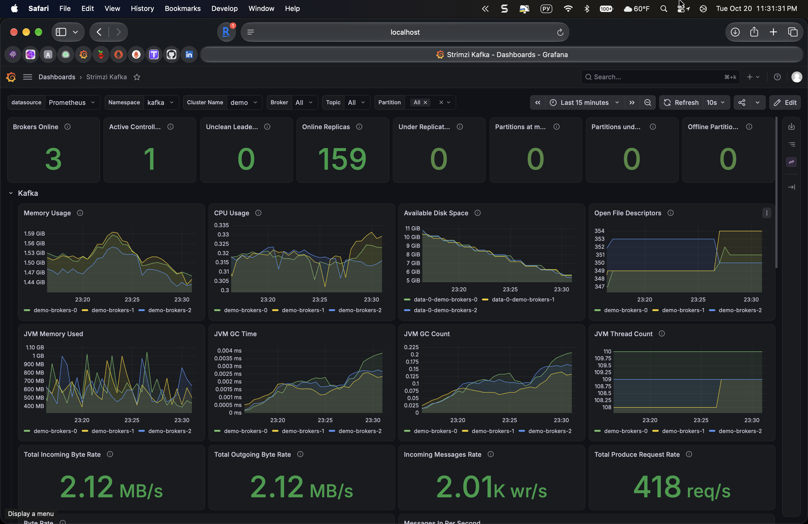
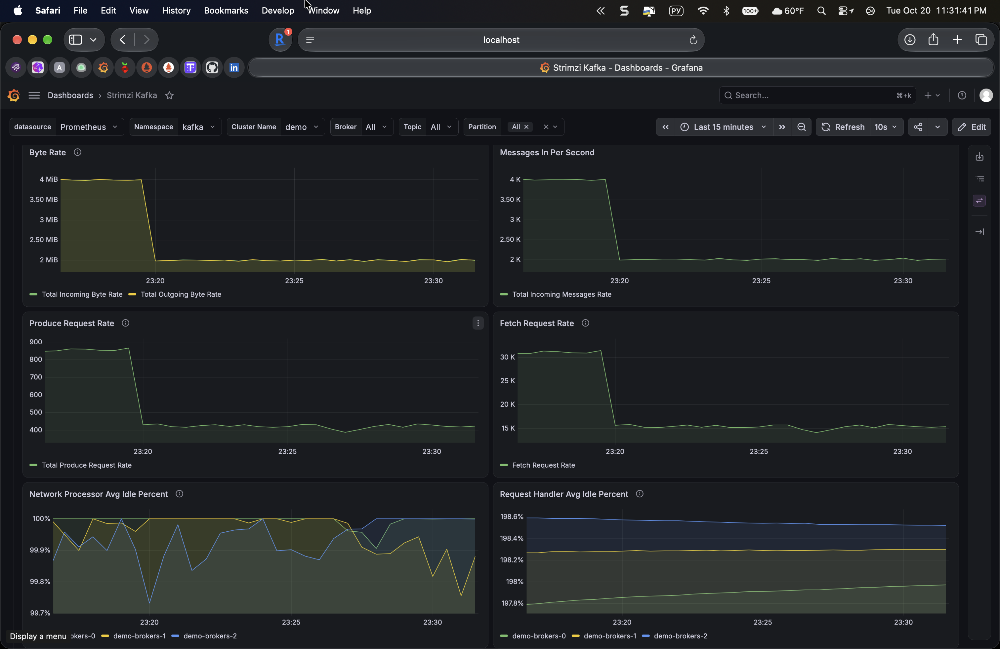
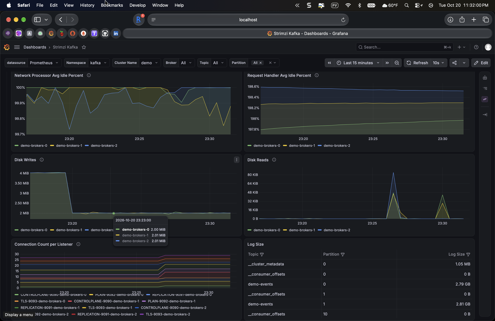
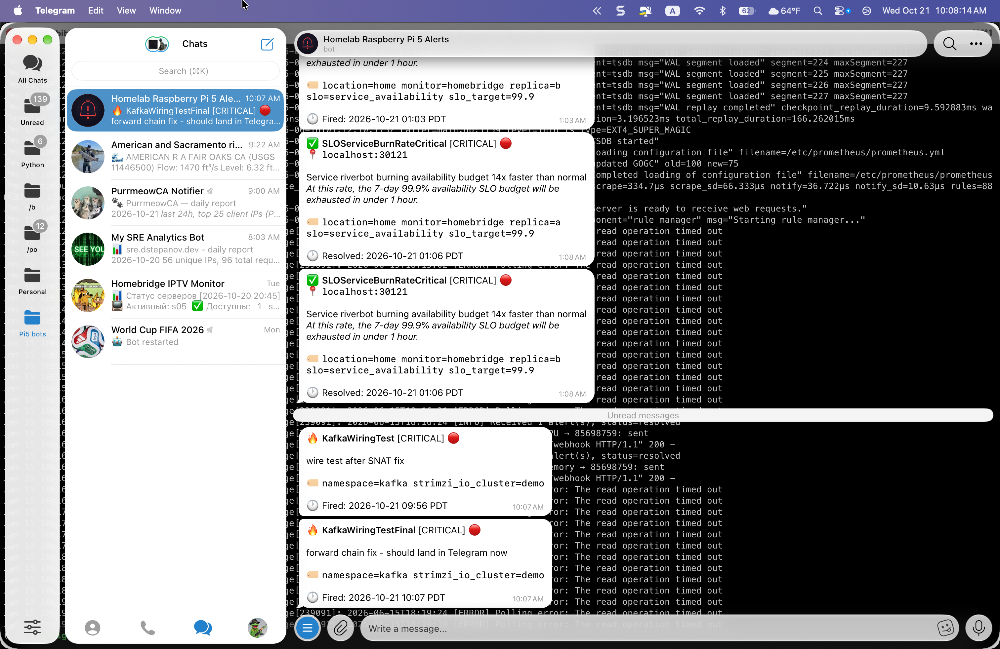

# kafka-slo-observability

[](https://github.com/bibigon14/kafka-slo-observability/actions/workflows/validate.yml)

Strimzi Kafka cluster on OCI Ampere A1 (k3s) with a full SRE observability
stack: JMX metrics, Grafana dashboards, Prometheus-Operator PodMonitors,
and multi-window multi-burn-rate SLO alerts.

The project exists to show what shipping Kafka with proper observability
actually looks like end to end on commodity ARM64 hardware - not just
"it runs", but "I can tell within one minute if it is burning error
budget, and I know whether to page or file a ticket."



## Stack

- **Kafka 3.9** via Strimzi Operator 0.47 in KRaft mode (no ZooKeeper)
- 3-replica KafkaNodePool, combined controller + broker roles
- **Metrics**: Kafka JMX Exporter on `:9404` exposing both the Kafka
  broker MBeans and the JVM internals; a small Prometheus recording-rule
  bridge maps the Micrometer naming used by the Strimzi cluster operator
  pod to the Prometheus Client naming the upstream dashboards expect
- **Monitoring**: kube-prometheus-stack (Prometheus Operator, Grafana,
  Alertmanager), PodMonitor + PrometheusRule CRDs
- **Dashboards**: upstream Strimzi Kafka Grafana JSON imported via the
  Grafana sidecar ConfigMap pattern
- **Alerts**: Google SRE Workbook burn-rate pattern - fast page at 14.4x /
  1h, slow ticket at 6x / 6h, plus hard failure alarms

## Layout

```
manifests/
  kafka/
    kafka-cluster.yaml              # KafkaNodePool + Kafka CR (KRaft)
    kafka-metrics-configmap.yaml    # JMX -> Prometheus exposition rules
  monitoring/
    kafka-podmonitor.yaml           # PodMonitor + strimzi label relabels
    kafka-slo-rules.yaml            # PrometheusRule: SLO burn-rate alerts
    jvm-rename-rules.yaml           # Micrometer -> Prom Client naming bridge
  workload/
    demo-workload.yaml              # KafkaTopic + producer + consumer
docs/
  architecture.md                   # how the pieces fit, metric sources
  screenshots/                      # live Grafana captures from OCI
```

## Deploy

Prerequisites: a k3s/kubernetes cluster with Strimzi Cluster Operator
installed in the `kafka` namespace and kube-prometheus-stack in
`monitoring` with `podMonitorSelectorNilUsesHelmValues=false` so
PodMonitors in other namespaces are picked up.

```bash
# 1. Kafka cluster + metrics ConfigMap
kubectl apply -f manifests/kafka/

# 2. Wait for the brokers to settle
kubectl -n kafka wait kafka/demo --for=condition=Ready --timeout=5m

# 3. Monitoring - PodMonitor + SLO rules + JVM naming bridge
kubectl apply -f manifests/monitoring/

# 4. Demo workload (optional - keeps the dashboards non-empty)
kubectl apply -f manifests/workload/

# 5. Import the upstream Strimzi Grafana dashboard
curl -sSfL https://raw.githubusercontent.com/strimzi/strimzi-kafka-operator/main/examples/metrics/grafana-dashboards/strimzi-kafka.json \
  | kubectl -n monitoring create configmap strimzi-kafka-dashboard \
      --from-file=strimzi-kafka.json=/dev/stdin --dry-run=client -o yaml \
  | kubectl label --local -f - grafana_dashboard=1 -o yaml \
  | kubectl apply -f -
```

## Live dashboard

Throughput, request rates and processor-idle percent under the demo workload:



Disk writes/reads per broker and per-topic log sizes (demo-events ~2.8 GB
per partition is the retention window at this write rate):



## Observability contract

### SLIs

- **Availability**: produce / fetch request success rate per broker
- **Durability**: `kafka_server_replicamanager_underreplicatedpartitions`
  must stay 0; `kafka_controller_kafkacontroller_offlinepartitionscount`
  must stay 0
- **Freshness**: `kafka_consumergroup_lag` for `demo-consumer-group`

### SLOs

- 99.9% produce availability over 28 days
- 0 under-replicated partitions over 28 days (hard SLO)
- Consumer lag < 10,000 messages for 99% of 28 days

### Alerts (multi-window multi-burn-rate)

| Alert | Window(s) | Burn rate | Severity |
|---|---|---|---|
| `KafkaOfflinePartitions` | instant | n/a (count > 0) | page |
| `KafkaUnderReplicatedPartitions` | 5m | n/a (count > 0) | page |
| `KafkaBrokerDown` | 2m | n/a (`up == 0`) | page |
| `KafkaConsumerLagBurnRateFast` | 1h / 5m | 14.4x | page |
| `KafkaConsumerLagBurnRateSlow` | 6h / 30m | 6x | ticket |

Fast + slow mirrors the Google SRE Workbook pattern: fast fires on an
incident big enough to burn 2% of the monthly budget in an hour; slow
catches a slower leak before it eats the budget.

## Alerting

Alertmanager routes every alert in the `kafka` namespace to a Telegram
bridge running on the homelab Raspberry Pi, over a WireGuard tunnel to
the OCI VM:

```
Prometheus (OCI) --fires--> Alertmanager (OCI) --webhook--> 10.0.0.1:30119 (homelab) --> Telegram bot
```



Config lives in `manifests/monitoring/kafka-alertmanager-config.yaml`
as an `AlertmanagerConfig` CRD in the `kafka` namespace. The parent
Alertmanager picks it up because `alertmanagerConfigSelector` and
`alertmanagerConfigNamespaceSelector` are empty (match-all) in the
kube-prometheus-stack chart.

A trap worth naming: on OCI Ampere A1 running Oracle Ubuntu 24.04 the
default `iptables FORWARD` chain starts with `reject with icmp
host-prohibited`, which drops every forwarded packet before policy
`ACCEPT` can help. Pod networking still appears to work because
Flannel keeps bridge traffic out of FORWARD, but anything a pod sends
over a tunnel interface like `wg0` gets rejected silently - the
Alertmanager pod logs show it as `dial tcp 10.0.0.1:30119: connect: no
route to host` and the alert fires but never reaches Telegram. Fix is
two lines (per-pod-CIDR source + conntrack return) at the top of
FORWARD, documented in [`docs/architecture.md`](docs/architecture.md).

## Lessons captured in `docs/`

- **PodMonitor relabels for dashboard filters** ([postmortem](docs/postmortems/2026-10-21-strimzi-grafana-no-data.md)). Strimzi's upstream
  Grafana dashboards filter JVM panels on `strimzi_io_name="<cluster>-kafka"`
  and template-var the pod name from `strimzi_io_pod_name`. Pod labels have
  these as `strimzi.io/name` and `strimzi.io/pod-name`; without an explicit
  relabel they never land on the metrics and every JVM panel reads "No data"
  even though metrics are being scraped healthily. A 92-line jvm_* scrape
  per broker won't help you here; the filter on the dashboard side still
  has to match.
- **Metric-source overlap on Strimzi 0.47 + Kafka 3.9**. The pods expose
  JVM internals twice - once via the Kafka JMX Exporter at `:9404`
  (Prometheus Client naming: `jvm_memory_used_bytes`,
  `jvm_gc_collection_seconds_*`) and once via Micrometer on the entity
  operator. Adding JVM rules to the JMX exporter config on top of the
  exporter's built-in JVM collector crashes it at scrape time with
  `duplicate metric name`. The fix is to leave JVM exposure to the
  exporter's built-in collector and use a tiny PrometheusRule to bridge
  the operator's Micrometer naming to the dashboard's expected
  Prometheus Client naming.
- **k3s local-path PVCs are not hard limits**. The brokers each got a
  10Gi persistent-claim, but k3s local-path provisioner is just a path
  on the host filesystem - no size quota is enforced. A perf-test
  producer running at 4 MB/s with `default.replication.factor=3`
  writes 12 MB/s to the host disk and will fill `/dev/sda1` long
  before any broker-side "disk free" alert fires. Keep an eye on
  `node_filesystem_avail_bytes` on the host too, not just
  `kafka_log_log_size`.
- **ARM64 free-tier footprint**. The whole cluster (3 brokers + operator
  + producer + consumer + kube-prometheus-stack) shares one Oracle Cloud
  Always Free Ampere A1 VM (2 OCPU, 12 GB RAM, arm64) with the
  [`cilium-l7-observability`](https://github.com/bibigon14/cilium-l7-observability)
  and [`ebpf-tcp-observer`](https://github.com/bibigon14/ebpf-tcp-observer)
  projects. See [`docs/architecture.md`](docs/architecture.md) for the
  resource budget.

## See also

- [cilium-l7-observability](https://github.com/bibigon14/cilium-l7-observability) - Cilium CNI + Hubble on the same OCI VM
- [ebpf-tcp-observer](https://github.com/bibigon14/ebpf-tcp-observer) - BPF kprobe TCP observer
- [homelab-observability](https://github.com/bibigon14/homelab-observability) - the Pi-side Thanos + Grafana stack

## License

MIT
